<!-- ============================================================
  ELROOT LABS — GitHub profile README
  Repo: github.com/elrootlabs/elrootlabs  (must match username)
  Brand: monochrome + cyan accent (#00E5FF)
============================================================= -->

<p align="center">
  
</p>

<p align="center">
  <a href="https://elrootlabs.com/">
    
  </a>
</p>

<p align="center">
  <a href="https://elrootlabs.com/"></a>
  <a href="https://x.com/elrootlabs"></a>
  <a href="https://instagram.com/elrootlabs"></a>
  <a href="mailto:hello@elrootlabs.com"></a>
  <a href="https://github.com/elrootlabs-org"></a>
</p>

<p align="center">
  
</p>


## `> whoami`

<table>
<tr>
<td width="58%" valign="top">

```ts
const elrootLabs = {
  type:      "Deep-tech lab",
  base:      "India 🇮🇳",
  mission:   "Engineering intelligence. Building what's next.",

  domains: [
    "Artificial Intelligence",
    "Software Engineering",
    "Robotics & IoT",
    "Edge Intelligence",
  ],

  stack: {
    frontend: ["React", "Next.js", "TypeScript", "Tailwind"],
    backend:  ["Node.js", "Python", "FastAPI"],
    infra:    ["Cloudflare", "Vercel", "Supabase", "Firebase"],
    hardware: ["Raspberry Pi", "Arduino", "ESP32"],
  },

  principles: [
    "Ship the smallest thing that proves the idea",
    "Hardware-first thinking, AI-native software",
    "Built to be useful. Built to last.",
  ],

  status: "🟢 shipping",
} as const;
```

</td>
<td width="42%" valign="top">

### ⚡ The Lab

Elroot Labs is an Indian deep-tech company engineering intelligent systems across **software, AI, robotics and connected hardware**.

We take on hard technical problems and turn them into practical systems for the real world.

> *"Useful. Scalable. Engineered to last."*

### 🧪 Currently in the lab

- 🏫 **School OS**: AI operating system for schools
- 🕶️ **VisionAR**: AR ads that bring posters to life
- 🤖 **Robotics & IoT**: edge devices with local inference
- 🚀 **SaaS portfolio**: shipping fast, scaling winners

</td>
</tr>
</table>


## `> ls ./domains`

<table>
<tr>
<td width="50%" valign="top">

#### 🧠 Artificial Intelligence
Intelligent applications, AI agents, workflow automation and AI-native architectures.

</td>
<td width="50%" valign="top">

#### 💻 Software Engineering
Production-grade software, SaaS platforms, APIs, backend systems and scalable infrastructure.

</td>
</tr>
<tr>
<td width="50%" valign="top">

#### 🤖 Robotics & IoT
Embedded systems, connected devices, robotics and intelligent hardware.

</td>
<td width="50%" valign="top">

#### 📡 Edge Intelligence
Resource-efficient computing, local inference and AI systems that run where the data lives.

</td>
</tr>
</table>


## `> cat ./stack`

<p align="center">
  <br/>
  <br/>
  
</p>


## `> git log --stats`

<p align="center">
  
  
</p>

<p align="center">
  
</p>

<p align="center">
  
</p>

<p align="center">
  
</p>

<!-- Snake eats your contribution grid. Generated by .github/workflows/snake.yml -->
<p align="center">
  <picture>
    <source media="(prefers-color-scheme: dark)" srcset="https://raw.githubusercontent.com/elrootlabs/elrootlabs/output/github-snake-dark.svg"/>
    <source media="(prefers-color-scheme: light)" srcset="https://raw.githubusercontent.com/elrootlabs/elrootlabs/output/github-snake.svg"/>
    
  </picture>
</p>


## `> ./contact.sh`

<p align="center">
  <b>Building something hard? Let's engineer it together.</b><br/><br/>
  <a href="mailto:hello@elrootlabs.com"></a>
</p>

<p align="center">
  
</p>
